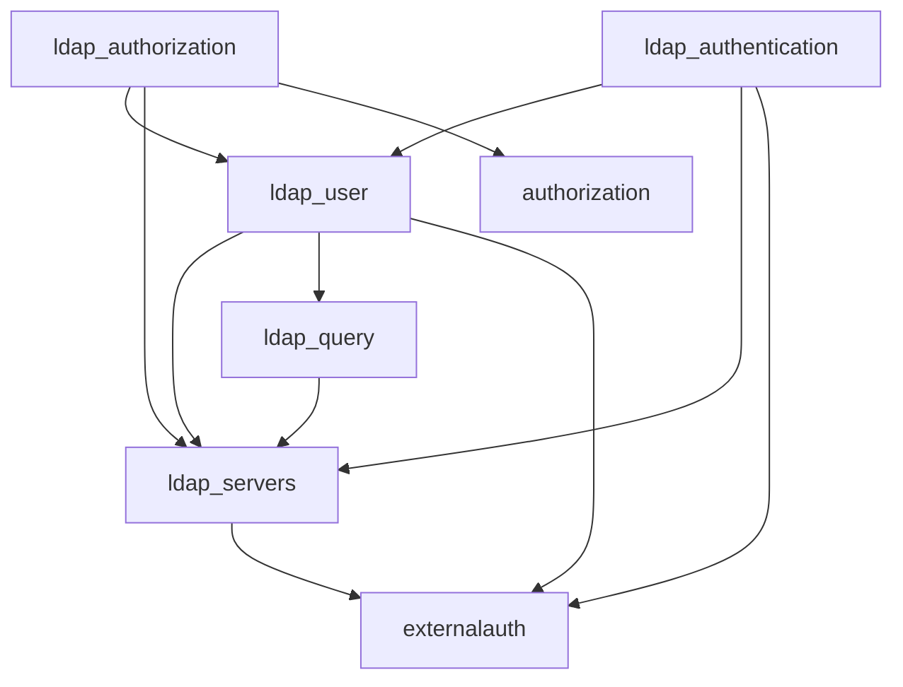

# Architecture

The suite is several Drupal modules around a single connection layer.

`ldap_servers` owns the `ldap_server` config entity, binds through Symfony
LDAP, and exposes managers other modules call. Enable only the modules your
site needs; the hidden `ldap` module is packaging, not a feature.

## Main services

| Service | Class | Role |
| ------- | ----- | ---- |
| `ldap.bridge` | `LdapBridge` | Creates the Symfony LDAP client and binds. |
| `ldap.user_manager` | `LdapUserManager` | Find, create, update, delete user entries. |
| `ldap.group_manager` | `LdapGroupManager` | Group membership and nested groups. |
| `ldap.token_processor` | `TokenProcessor` | `[attribute]` replacement. |
| `ldap.detail_log` | `LdapDetailLog` | Extra watchdog when debugging is on. |
| `ldap.drupal_user_processor` | `DrupalUserProcessor` | Drupal account create/update from LDAP. |
| `ldap.orphan_processor` | `OrphanProcessor` | Cron orphan check. |
| `ldap.group_user_update_processor` | `GroupUserUpdateProcessor` | Cron query sync. |
| `ldap.query` | `QueryController` | Run stored queries. |
| `ldap_authentication.login_validator` | `LoginValidatorLoginForm` | Core login form. |
| `ldap_authentication.login_validator_sso` | `LoginValidatorSso` | Hook for external SSO modules. |

User and group managers extend `LdapBaseManager` (search, bind
availability, entry writes).

## Case

LDAP is case-aware but not case-sensitive. Treat `memberOf` and `memberof`
as the same attribute when comparing. Server form fields for attribute
names are stored lowercase. Authorization mapping compares group DNs
case-insensitively.

## Config vs secrets

Server bind DN and password are config entity fields. Override them in
`settings.php` so they never enter exported YAML. See
[Installation](../getting-started/install.md).
